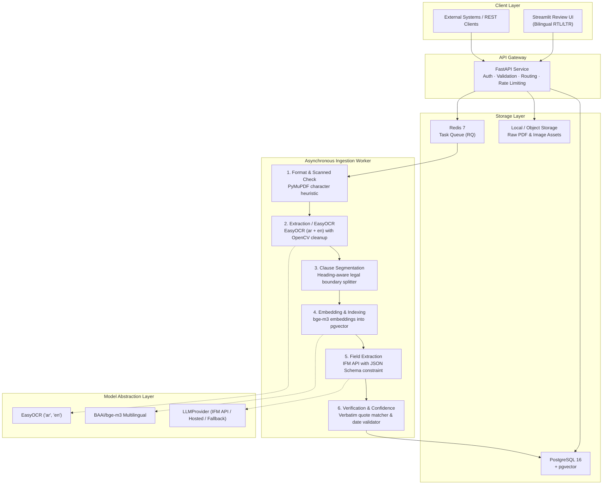

# ClauseLens — Implementation Plan

> **Repo:** [github.com/Faris-as/ClauseLens](https://github.com/Faris-as/ClauseLens) (public)  
> **Workspace:** `/home/faris/Desktop/eurusys/ClauseLens`  
> **OCR Engine:** EasyOCR (`ar` + `en` with PyTorch backend)  
> **LLM Layer:** IFM API (Institute of Foundation Models / MBZUAI) via OpenAI-compatible provider interface  
> **Time Allocation:** Full-time (~6–8 hrs/day)  
> **Date:** 10 November 2026  

---

## 1. Overview & Strategy

ClauseLens is a bilingual (English & Arabic) Contract Intelligence Assistant. It ingests contracts (digital & scanned PDF/images), extracts 10 core fields with verbatim citations and confidence scores, presents a human-in-the-loop review queue, provides grounded Q&A with strict anti-hallucination guards, and computes deadline alerts for renewals/expiries.

Key adaptations:
- **EasyOCR** for OCR: Native Arabic (`ar`) and English (`en`) support using CRAFT + CRNN neural models.
- **IFM API** for LLM: Utilizing Institute of Foundation Models (MBZUAI) API endpoints for frontier Arabic and English reasoning, hosted via standard OpenAI-compatible REST schemas, backed by our swappable `LLMProvider` interface.
- **PostgreSQL 16 + pgvector**: Unified relational store and vector similarity database.
- **FastAPI + Streamlit**: Enterprise REST API with token authentication, accompanied by a clean Streamlit human-in-the-loop review interface with RTL layout support.

---

## 2. Pre-requisites & Environment Checklist

| # | Item | Status / Action | Purpose |
|---|------|-----------------|---------|
| 1 | **Docker & Docker Compose** | Ready on system | Multi-container stack (FastAPI, PostgreSQL + pgvector, Redis, Worker) |
| 2 | **Python 3.12** | Local env / container | Core runtime |
| 3 | **EasyOCR dependencies** | PyTorch + Torchvision | Neural text detection & recognition (`ar` + `en`) |
| 4 | **IFM API Credentials** | To be provided by Faris (`IFM_API_KEY`, `IFM_BASE_URL`) | Hosted Arabic & English foundation models |
| 5 | **CUAD Dataset** | HuggingFace download | English evaluation baseline and 10 core field definitions |
| 6 | **ContractNLI Dataset** | Stanford NLP download | NDA inference & grounded Q&A unanswerable tests |
| 7 | **Arabic Synthetic Generator** | M0/M4 implementation | Synthetic UAE legal contracts (Federal, DIFC, ADGM) |

---

## 3. System Architecture

---

## 4. Milestone Breakdown

### M0 — Foundation (Days 1–5)
**Goal:** Complete project skeleton, Docker stack, database schema with migrations, CI/CD, and dataset acquisition.
- **Day 1:** Project scaffold (`pyproject.toml`, Docker Compose, `.env.example`, README).
- **Day 2:** SQLAlchemy 2.0 models for 9 core tables + pgvector + Alembic migrations.
- **Day 3:** GitHub Actions CI (ruff, mypy, pytest) + initial unit tests.
- **Day 4:** Data acquisition scripts (CUAD, ContractNLI) + `DATA_CARD.md`.
- **Day 5:** Gold set extraction schema (10 core fields) + sample fixtures.
- *Done when:* `docker compose up` boots clean; CI is green; initial tables migrate without error.

### M1 — Ingestion Pipeline (Days 6–10)
**Goal:** Document ingestion, EasyOCR (`ar` + `en`), clause-aware chunking, vector indexing.
- **Day 6:** `POST /api/v1/documents` endpoint, validation, raw storage, async job dispatch.
- **Day 7:** Digital text extraction with PyMuPDF, coordinate preservation, scanned heuristic.
- **Day 8:** EasyOCR integration (`ar` + `en`), image preprocessing (deskew, denoise, adaptive thresholding).
- **Day 9:** Clause segmentation (legal numbering & headings), bge-m3 embeddings, pgvector + full-text indexing.
- **Day 10:** Background worker (Redis + RQ), retry policies, end-to-end ingestion test.
- *Done when:* Both digital and scanned Arabic/English sample documents ingest to status `ready`.

### M2 — Extraction & Evaluation Harness (Days 11–17)
**Goal:** 10 core fields extraction via IFM API, citation verification, confidence calibration, evaluation harness.
- **Day 11:** `LLMProvider` interface with IFM API (OpenAI-compatible) driver and test mocks.
- **Day 12:** Prompt engineering with strict JSON schema for the 10 core fields + `not_found` sentinel.
- **Day 13:** Verbatim quote validator (exact & normalized matching, Arabic letter/diacritic normalization).
- **Day 14:** Date parsing (Gregorian, Arabic-Indic numerals) and cross-field consistency checks.
- **Day 15:** Regex/rule-based baseline extractor for fair comparative benchmarking.
- **Day 16:** Evaluation harness (`eval/run_eval.py`): Precision, Recall, F1, Exact Match, bootstrap 95% CIs.
- **Day 17:** First evaluation report generated on CUAD subset; error analysis documented.
- *Done when:* Evaluation runs with a single command and outputs reproducible performance metrics.

### M3 — Grounded Q&A, Deadline Engine & Review UI (Days 18–24)
**Goal:** Hybrid search Q&A, prompt injection guards, deadline computations, full REST API, Streamlit UI.
- **Day 18:** Hybrid retrieval (pgvector cosine + PostgreSQL full-text search) with reciprocal rank fusion.
- **Day 19:** Grounded Q&A prompt: strictly answers from cited passages or emits `not_found`.
- **Day 20:** Prompt-injection test suite (treating document text strictly as untrusted data).
- **Day 21:** Deadline engine: parsing expiry, renewal notice windows, and calculating upcoming dates.
- **Day 22:** Streamlit review interface: dual-pane document view, human approval/edit/reject, RTL Arabic support.
- **Day 23:** REST API security: JWT authentication, argon2 password hashing, user-tenant isolation.
- **Day 24:** End-to-end integration tests (Upload -> Ingest -> Review -> Q&A -> Export).
- *Done when:* Interactive demo fully functional in Streamlit and via documented Swagger UI.

### M4 — Arabic Legal Corpus & Model Benchmarking (Days 25–31)
**Goal:** Synthetic UAE contract generator, EasyOCR Arabic benchmark, multi-model evaluation.
- **Day 25:** Synthetic Arabic contract generator (NDAs, Service Agreements, UAE governing law: Federal, DIFC, ADGM).
- **Day 26:** Bilingual side-by-side contracts and cross-lingual clause alignment.
- **Day 27:** EasyOCR Arabic benchmark (CER/WER on degraded and stamped scans).
- **Day 28:** Arabic field extraction evaluation and error taxonomy.
- **Day 29:** Multi-model comparative benchmark using IFM API model families (Jais vs K2 vs reference).
- **Day 30:** Privacy audit & export module (JSON/CSV export of approved fields, complete data purge).
- **Day 31:** Review session with native Arabic speaker and updates to `DATA_CARD.md`.
- *Done when:* Documented Arabic extraction benchmark report with bootstrap confidence intervals.

### M5 — Production Hardening & Portfolio Deliverables (Days 32–37)
**Goal:** Final security audit, documentation, demo recording, and outreach package.
- **Day 32:** Security testing: cross-user data isolation, path traversal, injection payloads.
- **Day 33:** Risk flagging rules (unilateral termination, uncapped liability, auto-renewals).
- **Day 34:** Documentation finalization: `ARCHITECTURE.md`, `EVALUATION.md`, `SECURITY.md`, `README.md`.
- **Day 35:** 2–3 minute video demo recording (upload, review, Q&A, not_found case, eval report).
- **Day 36:** One-page technical brief on key architecture decisions and trade-offs.
- **Day 37:** Clean-clone verification test (from `git clone` to running app in <10 minutes).
- *Done when:* Repository is public, polished, and ready for Eurusys evaluation.
