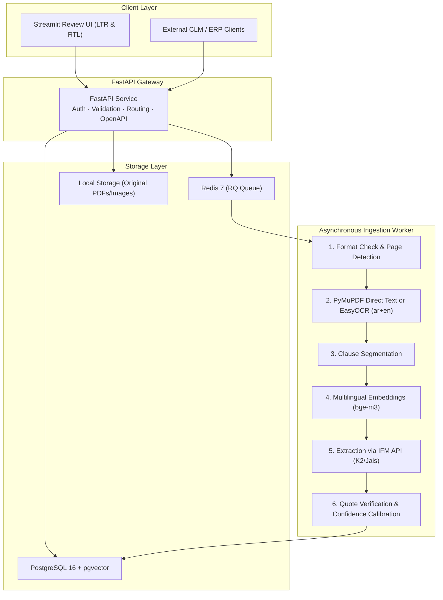

# Architecture Decision Record & System Design — ClauseLens

> **Status:** Approved  
> **Date:** 10 November 2026  
> **Author:** Faris Abdul Sukkur  

---

## 1. System Overview

ClauseLens is a bilingual (English & Arabic) service that reads contracts, extracts 10 core fields with verbatim citations, provides grounded Q&A, and alerts on upcoming renewal/notice deadlines.

---

## 2. Key Architectural Decisions (ADRs)

### ADR-01: PostgreSQL + pgvector for Storage & Embeddings
- **Context:** We need relational storage for users, documents, review actions, and deadlines, along with vector similarity search for semantic clause retrieval.
- **Decision:** Use PostgreSQL 16 with the `pgvector` extension instead of introducing a separate vector database (e.g. Pinecone, Qdrant).
- **Rationale:** Keeps operational complexity low. ACID guarantees allow atomic transaction handling when deleting documents and their associated embeddings.

### ADR-02: EasyOCR for Multilingual Document Recognition
- **Context:** UAE contracts frequently mix Arabic and English scripts, numerals, and complex ligatures.
- **Decision:** Use `EasyOCR` with `ar` and `en` models over baseline Tesseract.
- **Rationale:** EasyOCR's CRAFT character detection and deep learning CRNN recognition engine yield significantly higher resilience to cursive Arabic script and mixed-orientation legal headers.

### ADR-03: Foundation Model Layer via IFM API
- **Context:** Confidentiality, latency, and UAE sovereign relevance are critical.
- **Decision:** Abstract the LLM layer behind a unified `LLMProvider` interface, targeting the Institute of Foundation Models (MBZUAI / IFM API) as the default hosted engine.
- **Rationale:** Provides state-of-the-art Arabic and English legal reasoning while keeping the system lightweight and easily swappable.

### ADR-04: Mandatory Verbatim Quotes & Evidence Validation
- **Context:** Hallucinations in contract analysis pose unacceptable liability.
- **Decision:** Every extracted field must supply a verbatim quote and page citation. A validator checks substring presence before accepting a value.
- **Rationale:** Makes hallucinations programmatically detectable before a human reviewer even inspects the queue.
